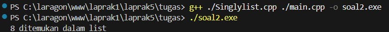
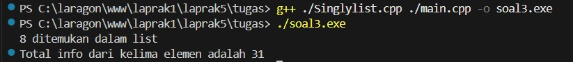

# <h1 align="center"> Modul 5 SINGLY LINKED LIST (BAGIAN KEDUA) </h1>
<p align="center">Khairil Ikhsan Hasibuan - 109082500174</p>
## Dasar Teori

### A. Singly Linked List

Singly linked list adalah struktur data berupa rangkaian *node* (elemen) yang saling terhubung melalui *pointer*. Setiap node menyimpan dua bagian, yaitu data (`info`) dan alamat node berikutnya (`next`). Hubungan antar node hanya satu arah sehingga penelusuran hanya bisa dilakukan dari depan ke belakang. Node pertama ditunjuk oleh `First`, sedangkan node terakhir memiliki `next` bernilai `Nil` (`NULL`) sebagai penanda akhir list. List dinyatakan kosong apabila `L.First = Nil`. Setiap elemen yang alamatnya disimpan pada pointer `P` dapat diakses melalui `P->info` dan `P->next`. Ilustrasi pada Gambar 5-1 modul menunjukkan list 9, 12, 8, 0, 2 dengan `First` menunjuk ke node berisi 9 dan node berisi 2 menunjuk ke `Nil`.

### B. Abstract Data Type (ADT)

Seluruh operasi dasar list merupakan bagian dari ADT singly linked list. Pada C/C++, ADT dipisah ke dalam beberapa file agar program lebih modular: file header (`*.h`) berisi definisi tipe dan *prototype* primitif, file implementasi (`*.cpp`) berisi realisasi primitif tersebut, dan `main.cpp` berperan sebagai *driver* yang hanya memanggil primitif. Pada file header digunakan `#ifndef ... #define ... #endif` (*include guard*) supaya isi header tidak terdeklarasi dua kali. Setiap primitif pada modul didokumentasikan dengan *Initial State* (I.S.) sebagai kondisi awal dan *Final State* (F.S.) sebagai kondisi akhir setelah primitif dijalankan.

### C. Operasi Dasar

Modul membagi primitif list ke dalam beberapa kelompok:

- **Pembuatan dan manajemen memori:** `CreateList` membentuk list kosong, `alokasi` memesan memori untuk node baru, dan `dealokasi` mengembalikan memori node ke sistem.
- **Penambahan elemen:** `insertFirst` (di awal list), `insertAfter` (setelah elemen tertentu), dan `insertLast` (di akhir list).
- **Penghapusan elemen:** `delFirst`, `delLast`, `delAfter`, dan `delP` (menghapus elemen berdasarkan nilai info).
- **Proses seluruh elemen:** `printInfo` menampilkan semua info, `nbList` menghitung jumlah elemen.
- **Proses terhadap list:** `delAll` menghapus seluruh elemen, `invertList` membalik urutan elemen, serta `copyList` dan `fCopyList` menyalin list.

### D. Searching

*Searching* adalah operasi pencarian node tertentu dengan cara mengunjungi setiap node mulai dari awal list dan berhenti setelah node yang dicari ditemukan. Modul 5 mendefinisikan tiga primitif pencarian:

- `findElm(L, X)` mengembalikan **alamat** elemen yang `info`-nya sama dengan `X`, atau `Nil` jika tidak ada.
- `fFindElm(L, P)` mengembalikan **boolean** yang menyatakan apakah elemen beralamat `P` ada di dalam list.
- `findBefore(L, P)` mengembalikan alamat elemen **sebelum** `P`, atau `Nil` jika `P` berada di awal list.

Karena hanya bisa ditelusuri satu arah, pencarian pada singly linked list memerlukan paling banyak sebanyak jumlah elemen kunjungan (n). Hasil pencarian berupa alamat inilah yang kemudian dipakai oleh operasi lain seperti *insert after*, *delete after*, dan *update*, sehingga operasi tersebut menjadi lebih mudah dilakukan.

### E. Traversal

*Traversal* adalah penelusuran seluruh node dari `First` sampai `Nil` dengan pointer bantu yang terus digeser menggunakan `P = P->next`. Pola ini menjadi dasar bagi `printInfo`, `nbList`, dan berbagai perhitungan terhadap isi list, misalnya menjumlahkan seluruh info. Perbedaannya dengan searching: traversal pada searching boleh berhenti lebih awal begitu data ditemukan, sedangkan traversal untuk menampilkan atau menghitung harus melewati semua node.

## Guided

Guided membahas ADT singly linked list untuk data buah (nama, jumlah, harga). Berbeda dengan prototype pada modul yang memakai tipe `list` dan field `info`, pada guided digunakan tipe `linkedlist` dan field `isidata` karena datanya berupa *record*, namun konsep dan cara kerjanya sama.

### 1. Program listBuah.h

```C++
#ifndef LISTBUAH_H
#define LISTBUAH_H

#define Nil nullptr

#include <iostream>
#include <string>
using namespace std;

struct buah {
    string nama;
    int    jumlah;
    float  harga;
};

typedef buah dataBuah;

typedef struct node *address;

struct node {
    dataBuah isidata;
    address  next;
};

struct linkedlist {
    address first;
};

bool    isEmpty(linkedlist List);
void    createList(linkedlist &List);
address alokasi(string nama, int jumlah, float harga);
void    dealokasi(address &node);
void    printList(linkedlist List);
void    insertFirst(linkedlist &List, address nodeBaru);
void    insertAfter(linkedlist &List, address nodeBaru, address prev);
void    insertLast(linkedlist &List, address nodeBaru);
void    delFirst(linkedlist &List);
void    delLast(linkedlist &List);
void    delAfter(linkedlist &List, address nodePrev);
int     nbList(linkedlist List);
void    deleteList(linkedlist &List);

void    updateFirst(linkedlist &List);
void    updateLast(linkedlist &List);
void    updateAfter(linkedlist &List, address nodePrev);

void    FindNodeByData(linkedlist list, string data);
void    FindNodeByAddress(linkedlist list, address node);
void    FindNodeByRange(linkedlist list, float hargaAwal, float hargaAkhir);

#endif
```

**Penjelasan**

File header ini hanya berisi deklarasi: tipe apa saja yang dipakai dan fungsi apa saja yang tersedia. Tidak ada logika program di dalamnya. Struktur tipenya tersusun bertingkat:

1. `buah` adalah *record* data yang berisi `nama` (string), `jumlah` (int), dan `harga` (float), lalu diberi alias `dataBuah`.
2. `node` membungkus satu `dataBuah` (`isidata`) bersama pointer `next` bertipe `address` (alias dari `node*`). Pointer ke `node` dideklarasikan lebih dulu lewat `typedef struct node *address` agar `node` boleh menunjuk ke dirinya sendiri.
3. `linkedlist` hanya memiliki satu field, yaitu `first`, yang menunjuk node pertama. Seluruh node lain dijangkau lewat rantai `next`.

`Nil` didefinisikan sebagai `nullptr` untuk penanda akhir list. Prototype fungsi dikelompokkan sesuai kelompok primitif pada modul: pengecekan dan pembuatan list, insert, delete, penghitungan (`nbList`), penghapusan list (`deleteList`), update, dan searching (`FindNodeByData`, `FindNodeByAddress`, `FindNodeByRange`). Seluruh isi dibungkus `#ifndef LISTBUAH_H` agar tidak terdeklarasi ganda ketika di-*include* oleh `listBuah.cpp` dan `main.cpp`.

### 2. Program listBuah.cpp

```C++
#include "listBuah.h"
#include <iostream>
using namespace std;

// cek apakah list kosong
bool isEmpty(linkedlist List) {
    return List.first == Nil;
}

// buat linked list kosong
void createList(linkedlist &List) {
    List.first = Nil;
}

// alokasi node baru
address alokasi(string nama, int jumlah, float harga) {
    address nodeBaru = new node;
    nodeBaru->isidata.nama   = nama;
    nodeBaru->isidata.jumlah = jumlah;
    nodeBaru->isidata.harga  = harga;
    nodeBaru->next           = Nil;
    return nodeBaru;
}

// dealokasi node
void dealokasi(address &node) {
    delete node;
    node = Nil;
}

// insert
void insertFirst(linkedlist &List, address nodeBaru) {
    nodeBaru->next = List.first;
    List.first     = nodeBaru;
}

void insertAfter(linkedlist &List, address nodeBaru, address prev) {
    (void)List; // tidak dipakai, tapi jaga signature
    if (prev != Nil) {
        nodeBaru->next = prev->next;
        prev->next     = nodeBaru;
    } else {
        cout << "Node sebelumnya tidak valid!" << endl;
    }
}

void insertLast(linkedlist &List, address nodeBaru) {
    if (isEmpty(List)) {
        List.first = nodeBaru;
    } else {
        address nodeBantu = List.first;
        while (nodeBantu->next != Nil) {
            nodeBantu = nodeBantu->next;
        }
        nodeBantu->next = nodeBaru;
    }
}

// delete
void delFirst(linkedlist &List) {
    if (!isEmpty(List)) {
        address nodeHapus = List.first;
        List.first = List.first->next;
        dealokasi(nodeHapus);
        cout << "Node pertama berhasil terhapus!" << endl;
    } else {
        cout << "List kosong!" << endl;
    }
}

void delLast(linkedlist &List) {
    if (!isEmpty(List)) {
        address nodeHapus = List.first;
        if (nodeHapus->next == Nil) {         // hanya satu node
            List.first = Nil;
            dealokasi(nodeHapus);
        } else {
            address nodePrev = Nil;
            while (nodeHapus->next != Nil) {
                nodePrev  = nodeHapus;
                nodeHapus = nodeHapus->next;
            }
            nodePrev->next = Nil;
            dealokasi(nodeHapus);
        }
        cout << "Node terakhir berhasil terhapus!" << endl;
    } else {
        cout << "List kosong!" << endl;
    }
}

void delAfter(linkedlist &List, address nodePrev) {
    if (isEmpty(List)) {
        cout << "List kosong!" << endl;
    } else if (nodePrev != Nil && nodePrev->next != Nil) {
        address nodeHapus = nodePrev->next;
        nodePrev->next    = nodeHapus->next;
        dealokasi(nodeHapus);
        cout << "Node setelah node " << nodePrev->isidata.nama
             << " berhasil terhapus!" << endl;
    } else {
        cout << "Node sebelumnya (prev) tidak valid!" << endl;
    }
}

// tampilkan list
void printList(linkedlist List) {
    if (isEmpty(List)) {
        cout << "List kosong." << endl;
    } else {
        address nodeBantu = List.first;
        while (nodeBantu != Nil) {
            cout << "Nama Buah : " << nodeBantu->isidata.nama
                 << ", Jumlah : " << nodeBantu->isidata.jumlah
                 << ", Harga : "  << nodeBantu->isidata.harga << endl;
            nodeBantu = nodeBantu->next;
        }
    }
}

// jumlah node
int nbList(linkedlist List) {
    int count = 0;
    address nodeBantu = List.first;
    while (nodeBantu != Nil) {
        count++;
        nodeBantu = nodeBantu->next;
    }
    return count;
}

// hapus seluruh list
void deleteList(linkedlist &List) {
    address nodeBantu = List.first;
    while (nodeBantu != Nil) {
        address nodeHapus = nodeBantu;
        nodeBantu = nodeBantu->next;
        dealokasi(nodeHapus);
    }
    List.first = Nil;
    cout << "List berhasil terhapus!" << endl;
}

// update
void updateFirst(linkedlist &List) {
    if (isEmpty(List)) {
        cout << "List kosong!" << endl;
    } else {
        cout << "Masukkan update data node pertama :" << endl;
        cout << "Nama buah : "; cin >> List.first->isidata.nama;
        cout << "Jumlah    : "; cin >> List.first->isidata.jumlah;
        cout << "Harga     : "; cin >> List.first->isidata.harga;
        cout << "Data Berhasil Diupdate!" << endl << endl;
    }
}

void updateLast(linkedlist &List) {
    if (isEmpty(List)) {
        cout << "List kosong!" << endl;
    } else {
        address nodeBantu = List.first;
        while (nodeBantu->next != Nil) {
            nodeBantu = nodeBantu->next;
        }
        cout << "Masukkan update data node terakhir :" << endl;
        cout << "Nama buah : "; cin >> nodeBantu->isidata.nama;
        cout << "Jumlah    : "; cin >> nodeBantu->isidata.jumlah;
        cout << "Harga     : "; cin >> nodeBantu->isidata.harga;
        cout << "Data Berhasil Diupdate!" << endl << endl;
    }
}

void updateAfter(linkedlist &List, address nodePrev) {
    if (isEmpty(List)) {
        cout << "List kosong!" << endl;
    } else if (nodePrev != Nil && nodePrev->next != Nil) {
        address nodeBantu = nodePrev->next;
        cout << "Masukkan update data node setelah node "
             << nodePrev->isidata.nama << " :" << endl;
        cout << "Nama buah : "; cin >> nodeBantu->isidata.nama;
        cout << "Jumlah    : "; cin >> nodeBantu->isidata.jumlah;
        cout << "Harga     : "; cin >> nodeBantu->isidata.harga;
        cout << "Data Berhasil Diupdate!" << endl << endl;
    } else {
        cout << "Node sebelumnya (prev) tidak valid!" << endl;
    }
}

// searching
void FindNodeByData(linkedlist list, string data) {
    if (isEmpty(list)) {
        cout << "List kosong!" << endl;
    } else {
        address nodeBantu = list.first;
        int posisi = 0;
        bool found = false;
        while (nodeBantu != Nil) {
            posisi++;
            if (nodeBantu->isidata.nama == data) {
                cout << "Data " << data << " ditemukan pada posisi ke-"
                     << posisi << "!" << endl;
                cout << "Nama Buah : " << nodeBantu->isidata.nama
                     << ", Jumlah : " << nodeBantu->isidata.jumlah
                     << ", Harga : "  << nodeBantu->isidata.harga << endl;
                found = true;
                break;
            }
            nodeBantu = nodeBantu->next;
        }
        if (!found) {
            cout << "Node dengan data " << data << " tidak ditemukan!" << endl;
        }
    }
    cout << endl;
}

void FindNodeByAddress(linkedlist list, address node) {
    if (isEmpty(list)) {
        cout << "List kosong!" << endl;
    } else {
        address nodeBantu = list.first;
        int posisi = 0;
        bool found = false;
        while (nodeBantu != Nil) {
            posisi++;
            if (nodeBantu == node) {
                cout << "Node ditemukan pada posisi ke-" << posisi << "!" << endl;
                cout << "Alamat node : " << nodeBantu << endl;
                cout << "Nama Buah : " << nodeBantu->isidata.nama
                     << ", Jumlah : " << nodeBantu->isidata.jumlah
                     << ", Harga : "  << nodeBantu->isidata.harga << endl;
                found = true;
                break;
            }
            nodeBantu = nodeBantu->next;
        }
        if (!found) {
            cout << "Node dengan alamat " << node
                 << " tidak ditemukan dalam list!" << endl;
        }
    }
    cout << endl;
}

void FindNodeByRange(linkedlist list, float hargaAwal, float hargaAkhir) {
    if (isEmpty(list)) {
        cout << "List kosong!" << endl;
    } else {
        address nodeBantu = list.first;
        int posisi = 0;
        bool found = false;
        cout << "--- Buah dalam range harga " << hargaAwal
             << " - " << hargaAkhir << " ---" << endl;
        cout << "-------------------------------------------" << endl;
        while (nodeBantu != Nil) {
            posisi++;
            float harga = nodeBantu->isidata.harga;
            if (harga >= hargaAwal && harga <= hargaAkhir) {
                cout << "Data ditemukan pada posisi ke-" << posisi << " :" << endl;
                cout << "Nama Buah : " << nodeBantu->isidata.nama
                     << ", Jumlah : " << nodeBantu->isidata.jumlah
                     << ", Harga : "  << nodeBantu->isidata.harga << endl;
                cout << "-------------------------------------------" << endl;
                found = true;
            }
            nodeBantu = nodeBantu->next;
        }
        if (!found) {
            cout << "Tidak ada data buah dalam range harga tersebut!" << endl;
            cout << "-------------------------------------------" << endl;
        }
    }
    cout << endl;
}
```

**Penjelasan**

File ini merealisasikan seluruh prototype di header. Cara kerja tiap fungsi dirangkum pada tabel berikut.

| Fungsi | Cara kerja | Kasus khusus / catatan |
|:--------------|:------------------------------|:------------------------------|
| `isEmpty`, `createList` | `isEmpty` membandingkan `first` dengan `Nil`. `createList` mengisi `first = Nil`. | `createList` wajib dipanggil lebih dulu, jika tidak `first` berisi nilai acak. |
| `alokasi`, `dealokasi` | `alokasi` membuat node dengan `new`, mengisi `isidata`, dan menset `next = Nil`. `dealokasi` melakukan `delete` lalu mengisi pointer dengan `Nil`. | Parameter `dealokasi` berupa referensi sehingga pointer asli ikut menjadi `Nil` (mencegah *dangling pointer*). |
| `insertFirst` | `next` node baru diarahkan ke `first` lama, kemudian `first` diarahkan ke node baru. | Tetap benar saat list kosong. Waktu konstan. |
| `insertAfter` | `nodeBaru->next = prev->next` lalu `prev->next = nodeBaru`. | Urutan dua langkah tidak boleh ditukar. Jika `prev` bernilai `Nil` ditampilkan pesan tidak valid. |
| `insertLast` | Jika list kosong, node baru menjadi `first`. Jika tidak, pointer bantu digeser sampai node yang `next`-nya `Nil`, lalu node baru disambungkan. | Perlu penelusuran sehingga proporsional dengan jumlah node. |
| `delFirst` | `first` disimpan ke `nodeHapus`, `first` digeser ke `next`, lalu `nodeHapus` didealokasi. | List kosong menampilkan pesan. |
| `delLast` | Jika hanya satu node, `first` dijadikan `Nil`. Jika lebih, penelusuran memakai dua pointer (`nodeHapus` dan `nodePrev` yang tertinggal satu langkah), lalu `nodePrev->next = Nil`. | Dua kasus perlu dipisah karena node tunggal tidak punya node sebelumnya. |
| `delAfter` | `nodeHapus = nodePrev->next`, `nodePrev->next` dilompatkan ke `nodeHapus->next`, lalu didealokasi. | Hanya jalan jika `nodePrev` dan `nodePrev->next` bukan `Nil`. |
| `printList`, `nbList` | Keduanya traversal dari `first`. `printList` menampilkan tiap node, `nbList` menambah counter tiap node. | List kosong: `printList` menampilkan pesan, `nbList` mengembalikan 0. |
| `deleteList` | Setiap node disimpan di `nodeHapus`, pointer bantu maju ke node berikutnya, baru node didealokasi. Terakhir `first = Nil`. | Pointer harus maju lebih dulu sebelum `delete`, kalau tidak alamat node berikutnya hilang. |
| `updateFirst`, `updateLast`, `updateAfter` | Menuju node target (pertama, terakhir lewat traversal, atau `nodePrev->next`) lalu mengisi ulang `isidata` dengan `cin`. | `updateAfter` memerlukan `nodePrev` yang valid dan memiliki node sesudahnya. |
| `FindNodeByData`, `FindNodeByAddress`, `FindNodeByRange` | Traversal dengan variabel `posisi` yang bertambah tiap node. Pencocokan berdasarkan nama, alamat node, atau harga di antara `hargaAwal` dan `hargaAkhir`. | Dua yang pertama berhenti (`break`) pada kecocokan pertama. `ByRange` menelusuri seluruh list karena hasilnya bisa lebih dari satu. Variabel `found` menandai apakah ada hasil. |

### 3. Program Main.cpp

```C++
#include "listBuah.h"
#include <iostream>
using namespace std;

int main() {
    linkedlist List;
    createList(List);

    address nodeA = Nil, nodeB = Nil, nodeC = Nil, nodeD = Nil, nodeE = Nil;

    nodeA = alokasi("Jeruk",    100,  3000);
    nodeB = alokasi("Apel",      75,  4000);
    nodeC = alokasi("Pir",       87,  5000);
    nodeD = alokasi("Semangka",  43, 11500);
    nodeE = alokasi("Durian",    15, 31450);

    insertFirst(List, nodeA);
    insertLast (List, nodeB);
    insertAfter(List, nodeC, nodeA);
    insertAfter(List, nodeD, nodeC);
    insertLast (List, nodeE);

    cout << "--- ISI LIST SETELAH DILAKUKAN INSERT ---" << endl;
    printList(List);
    cout << "jumlah node : " << nbList(List) << endl << endl;

    updateFirst(List);
    updateLast (List);
    updateAfter(List, nodeD);

    cout << "--- ISI LIST SETELAH DILAKUKAN UPDATE ---" << endl;
    printList(List);
    cout << "jumlah node : " << nbList(List) << endl << endl;

    FindNodeByData   (List, "Pir");
    FindNodeByAddress(List, nodeC);
    FindNodeByRange  (List, 5000, 10000);

    delFirst(List);
    delLast (List);
    delAfter(List, nodeC);

    cout << "--- ISI LIST SETELAH DILAKUKAN DELETE ---" << endl;
    printList(List);
    cout << "jumlah node : " << nbList(List) << endl << endl;

    deleteList(List);

    cout << "--- ISI LIST SETELAH DILAKUKAN HAPUS LIST ---" << endl;
    printList(List);
    cout << "jumlah node : " << nbList(List) << endl << endl;

    return 0;
}
```

**Penjelasan**

`main` bertindak sebagai driver yang menguji semua primitif secara berurutan. Lima node dialokasikan lebih dulu (`nodeA` sampai `nodeE`), kemudian disambungkan dengan insert yang berbeda-beda sehingga urutan akhirnya bukan urutan alokasi. Perubahan isi list pada tiap langkah ditunjukkan tabel berikut.

| No | Perintah | Isi list sesudahnya | Jumlah node |
|:-----|:------------------|:------------------------------|:------|
| 1 | `insertFirst(List, nodeA)` | Jeruk | 1 |
| 2 | `insertLast(List, nodeB)` | Jeruk → Apel | 2 |
| 3 | `insertAfter(List, nodeC, nodeA)` | Jeruk → Pir → Apel | 3 |
| 4 | `insertAfter(List, nodeD, nodeC)` | Jeruk → Pir → Semangka → Apel | 4 |
| 5 | `insertLast(List, nodeE)` | Jeruk → Pir → Semangka → Apel → Durian | 5 |
| 6 | `updateFirst`, `updateLast`, `updateAfter(List, nodeD)` | Data node ke-1 (Jeruk), node ke-5 (Durian), dan node ke-4 (Apel, yaitu node setelah Semangka) diganti sesuai input. Pir dan Semangka tidak berubah. | 5 |
| 7 | `FindNodeByData`, `FindNodeByAddress`, `FindNodeByRange` | Isi list tidak berubah. Pir dicari berdasarkan nama dan alamat `nodeC` (posisi ke-2), serta pencarian harga 5000 sampai 10000. | 5 |
| 8 | `delFirst`, `delLast`, `delAfter(List, nodeC)` | Node ke-1 dan ke-5 dihapus, lalu node setelah Pir (Semangka) dihapus. Sisa: Pir → node hasil update ke-4. | 2 |
| 9 | `deleteList` | List kosong | 0 |

Terdapat dua hal yang perlu diperhatikan. Pertama, `updateAfter(List, nodeD)` mengubah node **setelah** `nodeD`, bukan `nodeD` itu sendiri. Kedua, karena Pir dan Semangka tidak ikut di-update, pencarian `"Pir"` pada langkah 7 selalu berhasil. Setelah `deleteList`, `printList` menampilkan pesan list kosong dan `nbList` bernilai 0, yang membuktikan seluruh node telah didealokasi.

### Output Guided

Output berikut diperoleh dari contoh input update: node pertama = Mangga 50 6000, node terakhir = Lemon 20 2500, node setelah Semangka = Kiwi 30 7500 (isi input dapat berbeda pada tiap percobaan).

```text
--- ISI LIST SETELAH DILAKUKAN INSERT ---
Nama Buah : Jeruk, Jumlah : 100, Harga : 3000
Nama Buah : Pir, Jumlah : 87, Harga : 5000
Nama Buah : Semangka, Jumlah : 43, Harga : 11500
Nama Buah : Apel, Jumlah : 75, Harga : 4000
Nama Buah : Durian, Jumlah : 15, Harga : 31450
jumlah node : 5

Masukkan update data node pertama :
Nama buah : Mangga
Jumlah    : 50
Harga     : 6000
Data Berhasil Diupdate!

Masukkan update data node terakhir :
Nama buah : Lemon
Jumlah    : 20
Harga     : 2500
Data Berhasil Diupdate!

Masukkan update data node setelah node Semangka :
Nama buah : Kiwi
Jumlah    : 30
Harga     : 7500
Data Berhasil Diupdate!

--- ISI LIST SETELAH DILAKUKAN UPDATE ---
Nama Buah : Mangga, Jumlah : 50, Harga : 6000
Nama Buah : Pir, Jumlah : 87, Harga : 5000
Nama Buah : Semangka, Jumlah : 43, Harga : 11500
Nama Buah : Kiwi, Jumlah : 30, Harga : 7500
Nama Buah : Lemon, Jumlah : 20, Harga : 2500
jumlah node : 5

Data Pir ditemukan pada posisi ke-2!
Nama Buah : Pir, Jumlah : 87, Harga : 5000

Node ditemukan pada posisi ke-2!
Alamat node : 0x5588dddb0330
Nama Buah : Pir, Jumlah : 87, Harga : 5000

--- Buah dalam range harga 5000 - 10000 ---
-------------------------------------------
Data ditemukan pada posisi ke-1 :
Nama Buah : Mangga, Jumlah : 50, Harga : 6000
-------------------------------------------
Data ditemukan pada posisi ke-2 :
Nama Buah : Pir, Jumlah : 87, Harga : 5000
-------------------------------------------
Data ditemukan pada posisi ke-4 :
Nama Buah : Kiwi, Jumlah : 30, Harga : 7500
-------------------------------------------

Node pertama berhasil terhapus!
Node terakhir berhasil terhapus!
Node setelah node Pir berhasil terhapus!
--- ISI LIST SETELAH DILAKUKAN DELETE ---
Nama Buah : Pir, Jumlah : 87, Harga : 5000
Nama Buah : Kiwi, Jumlah : 30, Harga : 7500
jumlah node : 2

List berhasil terhapus!
--- ISI LIST SETELAH DILAKUKAN HAPUS LIST ---
List kosong.
jumlah node : 0
```

Output sesuai dengan tabel penelusuran: pada pencarian rentang harga muncul tiga node (posisi ke-1, ke-2, dan ke-4) karena harga 6000, 5000, dan 7500 berada di antara 5000 dan 10000, sedangkan Semangka (11500) dan Lemon (2500) berada di luar rentang. Sisa list setelah penghapusan adalah Pir dan Kiwi sebanyak 2 node.

## Unguided

### 1. Membuat ADT Singly Linked List (Singlylist.h, Singlylist.cpp, main.cpp)

**Soal:** membuat ADT singly linked list dengan `infotype` int, `address` pointer ke `ElmList`, `ElmList` berisi `info` dan `next`, `List` berisi `First`, serta primitif `createList`, `alokasi`, `dealokasi`, `printInfo`, dan `insertFirst`. Kemudian diuji pada `main.cpp` dengan memasukkan 2, 0, 8, 12, 9.

```C++
#ifndef SINGLYLIST_H
#define SINGLYLIST_H

#include <iostream>
using namespace std;

// Definisi tipe
typedef int infotype;
typedef struct ElmList *address;

struct ElmList {
    infotype info;
    address next;
};

struct List {
    address First;
};

// Penanda akhir list
const address Nil = NULL;

// Prototype primitif
void createList(List &L);
address alokasi(infotype x);
void dealokasi(address &P);
void printInfo(List L);
void insertFirst(List &L, address P);

#endif
```

```C++
#include "Singlylist.h"

// I.S. sembarang, F.S. terbentuk list kosong
void createList(List &L) {
    L.First = Nil;
}

// Memesan memori untuk satu elemen berisi x
address alokasi(infotype x) {
    address P = new ElmList;
    if (P != Nil) {
        P->info = x;
        P->next = Nil;
    }
    return P;
}

// Mengembalikan memori elemen P ke sistem
void dealokasi(address &P) {
    delete P;
    P = Nil;
}

// Menampilkan seluruh info dari elemen pertama sampai terakhir
void printInfo(List L) {
    address P = L.First;
    while (P != Nil) {
        cout << P->info;
        if (P->next != Nil) {
            cout << " ";
        }
        P = P->next;
    }
    cout << endl;
}

// Menempatkan elemen P pada awal list
void insertFirst(List &L, address P) {
    P->next = L.First;
    L.First = P;
}
```

```C++
#include "Singlylist.h"

int main() {
    List L;
    address P1, P2, P3, P4, P5 = Nil;
    createList(L);

    P1 = alokasi(2);
    insertFirst(L, P1);

    P2 = alokasi(0);
    insertFirst(L, P2);

    P3 = alokasi(8);
    insertFirst(L, P3);

    P4 = alokasi(12);
    insertFirst(L, P4);

    P5 = alokasi(9);
    insertFirst(L, P5);

    printInfo(L);
    return 0;
}
```

#### Output Unguided 1


*Output Unguided 1 (sesuai Gambar 5-2 pada modul)*

**Penjelasan**

- **Singlylist.h** menetapkan bentuk tipe sesuai soal. Berbeda dengan guided, datanya hanya satu nilai integer sehingga `ElmList` langsung berisi `info` bertipe `infotype`. `Nil` dibuat sebagai konstanta `NULL`, dan seluruh prototype ditulis sesuai spesifikasi soal.
- **Singlylist.cpp** merealisasikan lima primitif. `alokasi(x)` menjalankan `new ElmList`, mengisi `info = x`, dan `next = Nil` sehingga elemen baru belum terhubung ke mana pun. `printInfo` melakukan traversal dari `First` sampai `Nil`; spasi hanya dicetak jika masih ada elemen berikutnya, agar tidak ada spasi berlebih di ujung baris (sesuai tampilan `9 12 8 0 2`).
- **main.cpp** membuat list kosong lewat `createList(L)`, lalu lima kali melakukan pasangan `alokasi` dan `insertFirst`. Pointer `P1` sampai `P5` menampung alamat tiap elemen sesaat setelah dialokasikan.

Inti dari program ini ada pada `insertFirst`, yang hanya dua baris: `P->next = L.First` menyambungkan elemen baru ke elemen pertama lama, lalu `L.First = P` menjadikan elemen baru sebagai elemen pertama. Urutan keduanya tidak boleh dibalik, sebab jika `L.First` diubah lebih dulu, alamat elemen lama hilang dan sisa list tidak bisa dijangkau lagi. Karena setiap elemen selalu masuk di depan, urutan list adalah kebalikan dari urutan input:

| No | Perintah | Isi list (dari First) | Keterangan |
|:-----|:--------------------|:----------------|:--------------------------|
| 1 | `alokasi(2)`, `insertFirst` | 2 | List kosong, elemen 2 menjadi First. |
| 2 | `alokasi(0)`, `insertFirst` | 0 → 2 | 0 ditempatkan di depan 2. |
| 3 | `alokasi(8)`, `insertFirst` | 8 → 0 → 2 | 8 ditempatkan di depan 0. |
| 4 | `alokasi(12)`, `insertFirst` | 12 → 8 → 0 → 2 | 12 ditempatkan di depan 8. |
| 5 | `alokasi(9)`, `insertFirst` | 9 → 12 → 8 → 0 → 2 | Hasil akhir sama dengan Gambar 5-1 modul. |

Dengan demikian `printInfo(L)` mencetak `9 12 8 0 2`, persis seperti Gambar 5-2 pada modul.

### 2. Mencari Elemen dengan Info 8 (fungsi findElm)

**Soal:** mencari elemen yang berisi info 8 dengan membuat fungsi baru `findElm(L : List, x : infotype) : address`. Pada tahap ini hanya dua file yang berubah, yaitu `Singlylist.h` (tambahan prototype `findElm`) dan `Singlylist.cpp` (tambahan realisasi `findElm`), ditambah `main.cpp` yang memanggilnya.

```C++
#ifndef SINGLYLIST_H
#define SINGLYLIST_H

#include <iostream>
using namespace std;

// Definisi tipe
typedef int infotype;
typedef struct ElmList *address;

struct ElmList {
    infotype info;
    address next;
};

struct List {
    address First;
};

// Penanda akhir list
const address Nil = NULL;

// Prototype primitif
void createList(List &L);
address alokasi(infotype x);
void dealokasi(address &P);
void printInfo(List L);
void insertFirst(List &L, address P);
address findElm(List L, infotype x);   // pencarian elemen

#endif
```

```C++
#include "Singlylist.h"

// I.S. sembarang, F.S. terbentuk list kosong
void createList(List &L) {
    L.First = Nil;
}

// Memesan memori untuk satu elemen berisi x
address alokasi(infotype x) {
    address P = new ElmList;
    if (P != Nil) {
        P->info = x;
        P->next = Nil;
    }
    return P;
}

// Mengembalikan memori elemen P ke sistem
void dealokasi(address &P) {
    delete P;
    P = Nil;
}

// Menampilkan seluruh info dari elemen pertama sampai terakhir
void printInfo(List L) {
    address P = L.First;
    while (P != Nil) {
        cout << P->info;
        if (P->next != Nil) {
            cout << " ";
        }
        P = P->next;
    }
    cout << endl;
}

// Menempatkan elemen P pada awal list
void insertFirst(List &L, address P) {
    P->next = L.First;
    L.First = P;
}

// Mencari elemen dengan info = x
// Mengembalikan alamat elemen jika ada, Nil jika tidak ada
address findElm(List L, infotype x) {
    address P = L.First;
    while (P != Nil) {
        if (P->info == x) {
            return P;
        }
        P = P->next;
    }
    return Nil;
}
```

```C++
#include "Singlylist.h"

int main() {
    List L;
    address P1, P2, P3, P4, P5 = Nil;
    address found;
    createList(L);

    P1 = alokasi(2);   insertFirst(L, P1);
    P2 = alokasi(0);   insertFirst(L, P2);
    P3 = alokasi(8);   insertFirst(L, P3);
    P4 = alokasi(12);  insertFirst(L, P4);
    P5 = alokasi(9);   insertFirst(L, P5);

    found = findElm(L, 8);
    if (found != Nil) {
        cout << found->info << " ditemukan dalam list" << endl;
    } else {
        cout << "Elemen tidak ditemukan" << endl;
    }
    return 0;
}
```

#### Output Unguided 2



*Output Unguided 2 (sesuai Gambar 5-3 pada modul)*

**Penjelasan**

Bagian ini merupakan penerapan langsung materi **Searching** pada modul 5.1. `findElm` memiliki spesifikasi: mengembalikan alamat elemen dengan `P->info = X` jika ada, dan `Nil` jika tidak ada. Algoritmanya:

1. Pointer bantu `P` diisi `L.First`.
2. Selama `P` belum `Nil`, bandingkan `P->info` dengan `x`. Jika sama, langsung `return P` sehingga penelusuran berhenti saat itu juga.
3. Jika tidak sama, geser ke elemen berikutnya dengan `P = P->next`.
4. Bila perulangan selesai tanpa kecocokan, `return Nil`.

Penelusuran untuk `findElm(L, 8)` pada list 9 → 12 → 8 → 0 → 2:

| Kunjungan | `P->info` | Sama dengan 8? | Tindakan |
|:----|:-----|:-----|:--------------------------|
| 1 | 9 | Tidak | Geser ke elemen berikutnya. |
| 2 | 12 | Tidak | Geser ke elemen berikutnya. |
| 3 | 8 | Ya | `return P` (alamat elemen ketiga), pencarian berhenti. |

Elemen 0 dan 2 tidak pernah dikunjungi karena pencarian sudah berhenti. Pada `main.cpp`, hasil fungsi ditampung di `found` lalu diuji: bila `found != Nil` dicetak `found->info` diikuti teks "ditemukan dalam list", sebaliknya dicetak "Elemen tidak ditemukan". Pengujian terhadap `Nil` ini penting, sebab mengakses `found->info` ketika `found` bernilai `Nil` akan menyebabkan program error. Jika yang dicari tidak ada (misalnya 5), seluruh elemen akan dikunjungi lebih dulu sebelum `Nil` dikembalikan, dan itu merupakan kasus terburuk dari searching.

Perlu dicatat bahwa `findElm` mengembalikan **alamat**, bukan sekadar benar/salah. Alamat tersebut dapat langsung dipakai untuk operasi lanjutan seperti `insertAfter` atau `delAfter`. Bila hanya keberadaan yang perlu diketahui, modul menyediakan versi boolean `fFindElm`.

### 3. Menghitung Total Info Seluruh Elemen (fungsi sumInfo)

**Soal:** menghitung jumlah total info seluruh elemen (9 + 12 + 8 + 0 + 2 = 31). Perubahan pada tahap ini adalah penambahan fungsi `sumInfo` di `Singlylist.h` dan `Singlylist.cpp`, serta pemanggilannya di `main.cpp`.

```C++
#ifndef SINGLYLIST_H
#define SINGLYLIST_H

#include <iostream>
using namespace std;

// Definisi tipe
typedef int infotype;
typedef struct ElmList *address;

struct ElmList {
    infotype info;
    address next;
};

struct List {
    address First;
};

// Penanda akhir list
const address Nil = NULL;

// Prototype primitif
void createList(List &L);
address alokasi(infotype x);
void dealokasi(address &P);
void printInfo(List L);
void insertFirst(List &L, address P);
address findElm(List L, infotype x);   // pencarian elemen
infotype sumInfo(List L);              // total info seluruh elemen

#endif
```

```C++
#include "Singlylist.h"

// I.S. sembarang, F.S. terbentuk list kosong
void createList(List &L) {
    L.First = Nil;
}

// Memesan memori untuk satu elemen berisi x
address alokasi(infotype x) {
    address P = new ElmList;
    if (P != Nil) {
        P->info = x;
        P->next = Nil;
    }
    return P;
}

// Mengembalikan memori elemen P ke sistem
void dealokasi(address &P) {
    delete P;
    P = Nil;
}

// Menampilkan seluruh info dari elemen pertama sampai terakhir
void printInfo(List L) {
    address P = L.First;
    while (P != Nil) {
        cout << P->info;
        if (P->next != Nil) {
            cout << " ";
        }
        P = P->next;
    }
    cout << endl;
}

// Menempatkan elemen P pada awal list
void insertFirst(List &L, address P) {
    P->next = L.First;
    L.First = P;
}

// Mencari elemen dengan info = x
// Mengembalikan alamat elemen jika ada, Nil jika tidak ada
address findElm(List L, infotype x) {
    address P = L.First;
    while (P != Nil) {
        if (P->info == x) {
            return P;
        }
        P = P->next;
    }
    return Nil;
}

// Menjumlahkan info dari seluruh elemen list
infotype sumInfo(List L) {
    infotype total = 0;
    address P = L.First;
    while (P != Nil) {
        total = total + P->info;
        P = P->next;
    }
    return total;
}
```

```C++
#include "Singlylist.h"

int main() {
    List L;
    address P1, P2, P3, P4, P5 = Nil;
    address found;
    infotype total;
    createList(L);

    P1 = alokasi(2);   insertFirst(L, P1);
    P2 = alokasi(0);   insertFirst(L, P2);
    P3 = alokasi(8);   insertFirst(L, P3);
    P4 = alokasi(12);  insertFirst(L, P4);
    P5 = alokasi(9);   insertFirst(L, P5);

    found = findElm(L, 8);
    if (found != Nil) {
        cout << found->info << " ditemukan dalam list" << endl;
    } else {
        cout << "Elemen tidak ditemukan" << endl;
    }

    total = sumInfo(L);
    cout << "Total info dari kelima elemen adalah " << total << endl;
    return 0;
}
```

#### Output Unguided 3



*Output Unguided 3 (sesuai Gambar 5-4 pada modul)*

**Penjelasan**

`sumInfo` termasuk kelompok **proses terhadap seluruh elemen list** pada modul, bukan pencarian. Itu sebabnya berbeda dari `findElm`: tidak ada kondisi berhenti di tengah, karena semua elemen wajib ikut dijumlahkan. Langkah kerjanya:

1. Variabel `total` diinisialisasi **0**. Nilai awal ini penting karena 0 adalah elemen netral penjumlahan; tanpa inisialisasi, `total` berisi nilai sembarang dan hasilnya salah.
2. Pointer bantu `P` mulai dari `L.First` dan terus bergerak sampai `Nil`.
3. Pada setiap elemen, `P->info` ditambahkan ke `total`, lalu `P` digeser ke `P->next`.
4. Setelah traversal selesai, `total` dikembalikan sebagai hasil fungsi.

| Langkah | `P->info` | `total` sebelum | `total` sesudah |
|:----|:-----|:-----|:-----|
| 1 | 9 | 0 | 9 |
| 2 | 12 | 9 | 21 |
| 3 | 8 | 21 | 29 |
| 4 | 0 | 29 | 29 |
| 5 | 2 | 29 | 31 |

Nilai akhir 31 dikembalikan ke `main.cpp` dan ditampung di variabel `total`, lalu dicetak bersama kalimat "Total info dari kelima elemen adalah". Karena `L` dikirim *by value* dan `sumInfo` hanya membaca isi list, list asli tidak berubah. Pemanggilan `findElm(L, 8)` tetap dipertahankan di `main.cpp` sehingga output memuat dua baris sekaligus, hasil pencarian 8 dan hasil penjumlahan 31, sesuai Gambar 5-3 dan 5-4 pada modul.

## Kesimpulan

Praktikum Modul 5 membahas lanjutan singly linked list sebagai ADT dinamis, dengan penekanan pada operasi *searching* dan *traversal*. Implementasi dibuat modular dalam tiga file, yaitu header untuk tipe dan prototype, file implementasi untuk realisasi primitif, dan `main.cpp` sebagai driver.

Pada bagian Guided, ADT diterapkan pada data buah dan mencakup seluruh primitif: insert (`insertFirst`, `insertAfter`, `insertLast`), delete (`delFirst`, `delLast`, `delAfter`, `deleteList`), update, penghitungan node (`nbList`), serta pencarian berdasarkan nama, alamat, dan rentang harga. Penelusuran langkah demi langkah menunjukkan bahwa urutan akhir list ditentukan oleh jenis insert yang dipakai, bukan oleh urutan alokasi node.

Pada bagian Unguided, tiga tahap membangun ADT bertingkat. Tahap 1 membuktikan bahwa `insertFirst` menghasilkan urutan terbalik (9, 12, 8, 0, 2). Tahap 2 menambahkan `findElm`, yaitu pencarian yang berhenti saat data ditemukan dan mengembalikan `Nil` bila tidak ada. Tahap 3 menambahkan `sumInfo`, yaitu traversal penuh yang menjumlahkan seluruh info dengan hasil 31.

Secara keseluruhan, hampir semua operasi pada singly linked list bertumpu pada penelusuran node satu per satu melalui pointer `next`. Pemahaman terhadap pointer, alokasi memori dinamis, dan pemrograman modular dari modul ini menjadi bekal untuk mempelajari struktur data berikutnya.

## Referensi

[1] Malik, D. S. (2010). *Data Structures Using C++* (2nd ed.). Boston: Cengage Learning.

[2] Drozdek, A. (2013). *Data Structures and Algorithms in C++* (4th ed.). Boston: Cengage Learning.

[3] Modul 5 Singly Linked List (Bagian Kedua). Struktur Data, Telkom University.