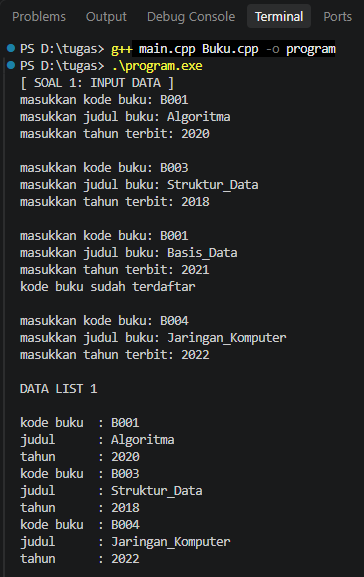
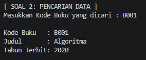
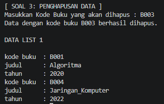

# <h1 align="center">Laporan Praktikum Modul 6 DOUBLY LINKED LIST (BAGIAN PERTAMA)</h1>
<p align="center">KHAIRIL IKHSAN HASIBUAN - 109082500174</p>

## **Dasar Teori**

Linked list atau senarai berantai merupakan struktur data yang digunakan untuk menyimpan sekumpulan data dalam bentuk node. Setiap node saling terhubung menggunakan pointer sehingga membentuk suatu rangkaian data. Struktur data ini bersifat dinamis karena jumlah elemennya dapat bertambah atau berkurang sesuai kebutuhan[1].

### **A. Doubly Linked List**<br/>
Doubly Linked List merupakan salah satu jenis linked list yang setiap node-nya memiliki dua pointer untuk menghubungkan data. Pointer `prev` berfungsi untuk menunjuk ke node sebelumnya, sedangkan pointer `next` menunjuk ke node berikutnya[1]. Pada struktur ini juga terdapat pointer `first` yang menunjuk ke node pertama dan pointer `last` yang menunjuk ke node terakhir dalam list. Dengan menggunakan kedua pointer tersebut, penelusuran data dapat dilakukan secara maju maupun mundur[1].

#### **1. Struktur dan Komponen**

Pada Doubly Linked List[1] terdapat beberapa komponen utama yang digunakan untuk menghubungkan setiap elemen dalam list:

| Komponen | Keterangan |
|---|---|
| **First** | Pointer yang menunjuk ke posisi elemen pertama pada list. |
| **Last** | Pointer yang menunjuk ke posisi elemen terakhir pada list. |
| **Next** | Pointer pada elemen yang mengarah ke elemen berikutnya. |
| **Prev** | Pointer pada elemen yang mengarah ke elemen sebelumnya. |

#### **2. Representasi Fisik (ADT)**
Pada bahasa C++, struktur data Doubly Linked List dibuat menggunakan tipe data `struct`. Setiap elemen list (ElmList) menyimpan data `info` dengan tipe infotype dan memiliki dua pointer, yaitu prev dan next[1]. Sementara itu, struktur `List` menyimpan pointer `first` dan `last` untuk menunjukkan elemen awal dan akhir list. List berada dalam keadaan kosong jika nilai `L.first = Nil[1]`.

#### **3. Kelebihan**
Doubly Linked List memiliki kelebihan dalam proses penelusuran data karena setiap elemennya memiliki pointer prev dan next. Dengan begitu, data dapat ditelusuri ke arah depan maupun ke arah belakang[1].

### **B. Operasi Dasar pada Doubly Linked List<br/>**

Doubly Linked List memiliki beberapa operasi dasar yang digunakan untuk mengelola data di dalam list, di antaranya:

#### **1. Insert (Penambahan Data)**

Insert merupakan operasi untuk memasukkan elemen baru ke dalam list. Penambahan data dapat dilakukan dengan beberapa cara[1]:

* **Insert First**: Menambahkan elemen baru pada bagian awal list. Pointer `next` dari elemen baru diarahkan ke elemen pertama sebelumnya, sedangkan pointer `prev` diatur menjadi `Nil`.
* **Insert Last**: Menambahkan elemen baru pada bagian akhir list. Pointer `prev` dari elemen baru diarahkan ke elemen terakhir sebelumnya, kemudian pointer `next` dari elemen terakhir tersebut dihubungkan ke elemen baru.
* **Insert After**: Memasukkan elemen baru tepat setelah elemen tertentu yang ditunjuk oleh `Prec`.

#### **2. Delete (Penghapusan Data)**

Delete merupakan operasi yang digunakan untuk menghilangkan elemen dari dalam list. Terdapat beberapa jenis penghapusan yang dapat dilakukan[1]:

* **Delete First**: Menghapus elemen pertama pada list. Pointer `L.first` dipindahkan ke elemen berikutnya, kemudian pointer `prev` pada elemen tersebut diatur menjadi `Nil`.
* **Delete Last**: Menghapus elemen terakhir pada list. Pointer `L.last` dipindahkan ke elemen sebelumnya, lalu pointer `next` dari elemen tersebut diatur menjadi `Nil`.
* **Delete After**: Menghapus elemen yang terletak setelah elemen tertentu (`Prec`). Pointer `next` dari `Prec` dihubungkan langsung ke elemen setelah elemen yang dihapus.

#### **3. Searching dan View**

Searching merupakan proses untuk mencari elemen di dalam list, sedangkan view digunakan untuk menampilkan data yang tersimpan. Pada Doubly Linked List, proses pencarian dan penampilan data dapat dilakukan dengan menelusuri list dari elemen pertama menuju elemen terakhir (`first` ke `last`) atau dari elemen terakhir menuju elemen pertama (`last` ke `first`)[1].

## **Guided** 

### **1. Doublylist.h**

```C++
#ifndef DOUBLYLIST_H
#define DOUBLYLIST_H

#include <iostream>
#include <string>

#define Nil NULL

// Latihan 1
struct infotype {
    std::string nopol; 
    std::string warna; 
    int thnBuat;      
};
typedef struct elmlist *address;
struct elmlist {
    infotype info;  
    address next;   
    address prev;   
};
struct List {
    address First; 
    address Last;  
};


// Latihan 1
void CreateList(List &L);
address alokasi(infotype x);
void dealokasi(address &P);
void printInfo(List L);
void insertLast(List &L, address P);

// Latihan 2
address findElm(List L, std::string nopol);

// Latihan 3
void deleteFirst(List &L, address &P);
void deleteLast(List &L, address &P);
void deleteAfter(List &L, address Prec, address &P);
void deleteElm(List &L, std::string nopol, bool &status);

#endif
```
File ini berisi struktur data yang digunakan untuk membuat Doubly Linked List. Di dalamnya terdapat `struct infotype` yang menyimpan data kendaraan, `struct elmlist` sebagai node yang memiliki pointer `next` dan `prev`, serta `struct List` yang menyimpan pointer `First` dan `Last`. File ini juga berisi fungsi untuk mengelola list, mulai dari membuat list, menambahkan data, mencari elemen, hingga menghapus data.

### **2. Doublylist.cpp**

```C++
#include "Doublylist.h"

// Latihan 1
void CreateList(List &L) {
    L.First = Nil;
    L.Last = Nil;
}

address alokasi(infotype x) {
    address P = new elmlist;
    P->info = x;
    P->next = Nil;
    P->prev = Nil; 
    return P;
}

void dealokasi(address &P) {
    delete P;
}

void printInfo(List L) {
    address P = L.Last;
    if (P == Nil) {
        std::cout << "List kosong." << std::endl;
        return;
    }
    while (P != Nil) {
        std::cout << "no polisi : " << P->info.nopol << std::endl;   
        std::cout << "warna     : " << P->info.warna << std::endl;   
        std::cout << "tahun     : " << P->info.thnBuat << std::endl; 
        P = P->prev;
    }
}

void insertLast(List &L, address P) {
    if (L.First == Nil) { 
        L.First = P;
        L.Last = P;
    } else {
        P->prev = L.Last;         
        (L.Last)->next = P;     
        L.Last = P;               
    }
}

// Latihan 2
address findElm(List L, std::string nopol) {
    address P = L.First;
    while (P != Nil) {
        if (P->info.nopol == nopol) {
            return P;
        }
        P = P->next;
    }
    return Nil;
}

// Latihan 3
void deleteFirst(List &L, address &P) {
    if (L.First == Nil) return;

    P = L.First; 
    if (L.First == L.Last) { 
        L.First = Nil;
        L.Last = Nil;
    } else {
        L.First = P->next;     
        (L.First)->prev = Nil; 
        P->next = Nil;         
    }
}

void deleteLast(List &L, address &P) {
    if (L.First == Nil) return;

    P = L.Last; 
    if (L.First == L.Last) { 
        L.First = Nil;
        L.Last = Nil;
    } else {
        L.Last = P->prev;      
        (L.Last)->next = Nil; 
        P->prev = Nil;         
    }
}

void deleteAfter(List &L, address Prec, address &P) {
    if (Prec == Nil || Prec->next == Nil) return;

    P = Prec->next;
    if (P == L.Last) {
        deleteLast(L, P);
    } else {
        Prec->next = P->next;     
        (P->next)->prev = Prec; 
        P->next = Nil;            
        P->prev = Nil;           
    }
}

void deleteElm(List &L, std::string nopol, bool &status) {
    address P = findElm(L, nopol);
    status = false;

    if (P != Nil) {
        if (P == L.First) {
            deleteFirst(L, P);
        } else if (P == L.Last) {
            deleteLast(L, P);
        } else {
            address Prec = P->prev;
            deleteAfter(L, Prec, P);
        }
        dealokasi(P); 
        status = true;
    }
}
```
File ini berisi fungsi-fungsi yang digunakan untuk mengelola Doubly Linked List. Fungsi `insertLast` digunakan untuk menambahkan node di bagian akhir list dengan mengatur pointer `prev` dan `next`. Prosedur `printInfo` menampilkan data kendaraan dari `Last` ke `First`. Fungsi `findElm` digunakan untuk mencari data berdasarkan nomor polisi. Sedangkan fungsi `deleteElm` digunakan untuk mencari node yang akan dihapus, lalu memanggil fungsi `deleteFirst`, `deleteLast`, atau `deleteAfter` sesuai posisi node tersebut.

### **3. main.cpp**

```C++
#include <iostream>
#include "Doublylist.h"
using namespace std;

void inputData(List &L) {
    infotype data;
    address P;

    cout << "masukkan nomor polisi: "; cin >> data.nopol;
    cout << "masukkan warna kendaraan: "; cin >> data.warna;
    cout << "masukkan tahun kendaraan: "; cin >> data.thnBuat;
    if (findElm(L, data.nopol) == Nil) {
        P = alokasi(data); 
        insertLast(L, P);  
    } else {
        cout << "nomor polisi sudah terdaftar" << endl; 
    }
}

int main() {
    List L;
    CreateList(L); 
    address P;

    // Latihan 1
    inputData(L); 
    inputData(L); 
    inputData(L); 
    inputData(L); 

    cout << "\nDATA LIST 1" << endl; 
    printInfo(L); 

    // Latihan 2
    string nopolCari;
    cout << "\nMasukkan Nomor Polisi yang dicari : "; 
    cin >> nopolCari; 
    
    P = findElm(L, nopolCari); 
    if (P != Nil) {
        cout << "Nomor Polisi : " << P->info.nopol << endl; 
        cout << "Warna        : " << P->info.warna << endl; 
        cout << "Tahun        : " << P->info.thnBuat << endl; 
    } else {
        cout << "Data dengan nomor polisi " << nopolCari << " tidak ditemukan." << endl;
    }

    // Latihan 3
    string nopolHapus;
    bool hapusBerhasil;
    cout << "\nMasukkan Nomor Polisi yang akan dihapus : ";
    cin >> nopolHapus;

    deleteElm(L, nopolHapus, hapusBerhasil); 

    if (hapusBerhasil) {
        cout << "Data dengan nomor polisi " << nopolHapus << " berhasil dihapus." << endl; 
    } else {
        cout << "Data dengan nomor polisi " << nopolHapus << " tidak ditemukan." << endl;
    }
    cout << "\nDATA LIST 1" << endl; 
    printInfo(L); 

    return 0;
}
```
File ini merupakan program utama yang digunakan untuk menguji fungsi-fungsi pada ADT Doubly Linked List. Program melakukan input data kendaraan dan mengecek nomor polisi menggunakan `findElm` agar tidak ada data yang sama. Setelah itu, program melakukan pencarian data berdasarkan nomor polisi yang dimasukkan pengguna, kemudian menguji proses penghapusan data. Setelah data dihapus, program menampilkan kembali isi list untuk melihat apakah data tersebut sudah berhasil dihapus.


## **Unguided **

## **SOAL Modul 6**

### **1. Pembuatan ADT Dasar dan Insert Data**
Buatlah ADT Doubly Linked List sebagai berikut di dalam file "Buku.h":
```C++
Type infotype : buku <
 kodeBuku : string
 judul : string
 thnTerbit : integer
>
Type address : pointer to ElmList
Type ElmList <
 info : infotype
 next : address
 prev : address
>
Type List <
 First : address
 Last : address
>
procedure CreateList( input/output L : List )
function alokasi( x : infotype ) -> address
procedure dealokasi( input/output P : address )
procedure printInfo( input L : List )
procedure insertLast( input/output L : List, input P : address )
```
Buatlah implementasi ADT Doubly Linked List pada file “Buku.cpp" dan cobalah hasil implementasi ADT 
tersebut pada file "main.cpp". Pastikan sistem melakukan pengecekan duplikasi kodeBuku sebelum 
memasukkan data baru ke dalam list.

### **2. Pencarian Elemen (Searching)**
Carilah elemen dengan kode buku B001 dengan membuat fungsi baru:
fungsi `findElm( L : List, x : infotype ) : address`

### **3. Penghapusan Elemen (Delete)**
Hapus elemen dengan kode buku B003 dengan membuat prosedur delete berikut:
```C++
procedure deleteFirst( input/output L : List, input/output P : address )
procedure deleteLast( input/output L : List, input/output P : address )
procedure deleteAfter( input Prec : address, input/output P : address )
```

```C++
// Buku.h
#ifndef BUKU_H
#define BUKU_H

#include <iostream>
#include <string>
using namespace std;

#define Nil NULL

struct buku {
    string kodeBuku;
    string judul;
    int thnTerbit;
};

typedef buku infotype;
typedef struct ElmList *address;

struct ElmList {
    infotype info;
    address next;
    address prev;
};

struct List {
    address First;
    address Last;
};

void CreateList(List &L);
address alokasi(infotype x);
void dealokasi(address &P);
void printInfo(List L);
void insertLast(List &L, address P);

address findElm(List L, string kodeBuku);

void deleteFirst(List &L, address &P);
void deleteLast(List &L, address &P);
void deleteAfter(address Prec, address &P);

#endif
```

```C++
//Buku.cpp
#include "Buku.h"
#include <iostream>

using namespace std;

void CreateList(List &L) {
    L.First = Nil;
    L.Last = Nil;
}

address alokasi(infotype x) {
    address P = new ElmList;
    if (P != Nil) {
        P->info = x;
        P->next = Nil;
        P->prev = Nil;
    }
    return P;
}

void dealokasi(address &P) {
    delete P;
    P = Nil;
}

void printInfo(List L) {
    address P = L.First;
    if (P == Nil) {
        cout << "List Kosong" << endl;
    } else {
        while (P != Nil) {
            cout << "kode buku  : " << P->info.kodeBuku << endl;
            cout << "judul      : " << P->info.judul << endl;
            cout << "tahun      : " << P->info.thnTerbit << endl;
            P = P->next;
        }
    }
}

void insertLast(List &L, address P) {
    if (L.First == Nil) {
        L.First = P;
        L.Last = P;
    } else {
        P->prev = L.Last;
        L.Last->next = P;
        L.Last = P;
    }
}

address findElm(List L, string kodeBuku) {
    address P = L.First;
    bool found = false;
    while (P != Nil && !found) {
        if (P->info.kodeBuku == kodeBuku) {
            found = true;
        } else {
            P = P->next;
        }
    }
    return P;
}

void deleteFirst(List &L, address &P) {
    if (L.First == Nil) {
        P = Nil;
    } else if (L.First == L.Last) {
        P = L.First;
        L.First = Nil;
        L.Last = Nil;
        P->next = Nil;
        P->prev = Nil;
    } else {
        P = L.First;
        L.First = L.First->next;
        L.First->prev = Nil;
        P->next = Nil;
    }
}

void deleteLast(List &L, address &P) {
    if (L.First == Nil) {
        P = Nil;
    } else if (L.First == L.Last) {
        P = L.Last;
        L.First = Nil;
        L.Last = Nil;
        P->next = Nil;
        P->prev = Nil;
    } else {
        P = L.Last;
        L.Last = L.Last->prev;
        L.Last->next = Nil;
        P->prev = Nil;
    }
}

void deleteAfter(address Prec, address &P) {
    if (Prec != Nil && Prec->next != Nil) {
        P = Prec->next;
        Prec->next = P->next;
        if (P->next != Nil) {
            P->next->prev = Prec;
        }
        P->next = Nil;
        P->prev = Nil;
    } else {
        P = Nil;
    }
}
```

```C++
//main.cpp
#include "Buku.h"
#include <iostream>
#include <string>

using namespace std;

int main() {
    List L;
    CreateList(L);

    cout << "[ SOAL 1: INPUT DATA ]" << endl;
    infotype b1;
    cout << "masukkan kode buku: "; cin >> b1.kodeBuku;
    cout << "masukkan judul buku: "; cin >> b1.judul;
    cout << "masukkan tahun terbit: "; cin >> b1.thnTerbit;
    insertLast(L, alokasi(b1));
    cout << endl;

    infotype b2;
    cout << "masukkan kode buku: "; cin >> b2.kodeBuku;
    cout << "masukkan judul buku: "; cin >> b2.judul;
    cout << "masukkan tahun terbit: "; cin >> b2.thnTerbit;
    insertLast(L, alokasi(b2));
    cout << endl;

    infotype b3;
    cout << "masukkan kode buku: "; cin >> b3.kodeBuku;
    cout << "masukkan judul buku: "; cin >> b3.judul;
    cout << "masukkan tahun terbit: "; cin >> b3.thnTerbit;

    address cek = findElm(L, b3.kodeBuku);
    if (cek != Nil) {
        cout << "kode buku sudah terdaftar" << endl;
    } else {
        insertLast(L, alokasi(b3));
    }
    cout << endl;

    infotype b4;
    cout << "masukkan kode buku: "; cin >> b4.kodeBuku;
    cout << "masukkan judul buku: "; cin >> b4.judul;
    cout << "masukkan tahun terbit: "; cin >> b4.thnTerbit;
    insertLast(L, alokasi(b4));
    cout << endl;

    cout << "DATA LIST 1" << endl;
    cout << endl;
    printInfo(L);
    cout << endl;

    cout << "[ SOAL 2: PENCARIAN DATA ]" << endl;
    cout << "Masukkan Kode Buku yang dicari : ";
    string cariKode;
    cin >> cariKode;

    address hasilCari = findElm(L, cariKode);
    if (hasilCari != Nil) {
        cout << endl;
        cout << "Kode Buku   : " << hasilCari->info.kodeBuku << endl;
        cout << "Judul       : " << hasilCari->info.judul << endl;
        cout << "Tahun Terbit: " << hasilCari->info.thnTerbit << endl;
    } else {
        cout << "Data tidak ditemukan." << endl;
    }
    cout << endl;

    cout << "[ SOAL 3: PENGHAPUSAN DATA ]" << endl;
    cout << "Masukkan Kode Buku yang akan dihapus : ";
    string hapusKode;
    cin >> hapusKode;

    address targetHapus = findElm(L, hapusKode);

    if (targetHapus != Nil) {
        address P;
        if (targetHapus == L.First) {
            deleteFirst(L, P);
        } else if (targetHapus == L.Last) {
            deleteLast(L, P);
        } else {
            address Prec = targetHapus->prev;
            deleteAfter(Prec, P);
        }
        dealokasi(P);
        cout << "Data dengan kode buku " << hapusKode << " berhasil dihapus." << endl;
    } else {
        cout << "Data tidak ditemukan." << endl;
    }

    cout << endl;
    cout << "DATA LIST 1" << endl;
    cout << endl;
    printInfo(L);

    return 0;
}
```

### **Output Unguided**  :

##### **Output 1**

##### **Output 2**

##### **Output 3**


1. Pembuatan ADT Dasar dan Insert Data (Soal 1)
Pada soal pertama, program melakukan input data buku sebanyak empat kali. Sebelum data dimasukkan ke dalam list menggunakan fungsi `insertLast`, program mengecek terlebih dahulu apakah kode buku sudah ada menggunakan fungsi `findElm`. Jika kode buku sudah terdaftar, seperti kode B001 pada input ketiga, program akan menampilkan pesan "kode buku sudah terdaftar". Jika kode buku belum ada, fungsi `alokasi` digunakan untuk membuat node baru, lalu node tersebut dimasukkan ke akhir list. Setelah semua data selesai diinput, fungsi `printInfo` menampilkan data buku yang tersimpan di dalam list dari First hingga Last.

2. Pencarian Elemen (Soal 2)
Pada soal kedua, program menguji fungsi `findElm` untuk mencari data buku berdasarkan kode yang dimasukkan pengguna, yaitu B001 pada contoh output. Fungsi `findElm` menelusuri list mulai dari elemen pertama menggunakan pointer `next` sampai menemukan kode buku yang sesuai. Jika data ditemukan, program menampilkan kode buku, judul, dan tahun terbit. Jika data tidak ditemukan sampai akhir list, program akan menampilkan pesan "Data tidak ditemukan."


3. Penghapusan Elemen (Soal 3)
Pada soal ketiga, program menguji proses penghapusan data buku dengan kode B003. Program terlebih dahulu mencari node menggunakan fungsi `findElm`. Jika node ditemukan, program akan mengecek posisinya di dalam list. Karena B003 berada di tengah list, program mengambil node sebelumnya melalui `targetHapus->prev`, lalu memanggil prosedur `deleteAfter`. Prosedur ini mengatur kembali pointer `next` dan `prev` agar node yang akan dihapus terlepas dari list. Setelah itu, memori node dibebaskan menggunakan fungsi `dealokasi`. Terakhir, program menampilkan kembali isi list untuk memastikan data dengan kode buku B003 sudah tidak ada di dalam list.


## **Kesimpulan**
Berdasarkan praktikum Modul 6 mengenai Doubly Linked List, dapat disimpulkan bahwa:

Doubly Linked List merupakan struktur data dinamis yang setiap node-nya memiliki dua pointer, yaitu `next` untuk menunjuk ke node berikutnya dan `prev` untuk menunjuk ke node sebelumnya.

Doubly Linked List memiliki dua pointer utama, yaitu `First` sebagai awal list dan `Last` sebagai akhir list. Dengan adanya kedua pointer tersebut, data dapat ditelusuri dari dua arah, yaitu dari `First` ke `Last` dan dari `Last` ke `First`.

Operasi dasar seperti penambahan data menggunakan `insertLast`, pencarian menggunakan `findElm`, dan penghapusan menggunakan `deleteFirst`, `deleteLast`, serta `deleteAfter` dilakukan dengan mengatur pointer `next` dan `prev`. Pengaturan pointer perlu dilakukan dengan benar agar hubungan antar-node tetap terjaga.

Pengecekan data menggunakan `findElm` sebelum penambahan diperlukan untuk mencegah adanya data yang sama. Selain itu, pencarian sebelum penghapusan juga membantu memastikan node yang dihapus sesuai dengan data yang ingin dihapus. Setelah node dilepas dari list, memori node tersebut dibebaskan menggunakan fungsi `dealokasi`.


## **Referensi**
[1] Triase. (2020). Diktat Edisi Revisi: STRUKTUR DATA. Medan: Universitas Islam Negeri Sumatera Utara Medan.

[2] Indahyati, Uce., & Rahmawati Yunianita. (2020). BUKU AJAR ALGORITMA DAN PEMROGRAMAN DALAM BAHASA C++. Sidoarjo: Umsida Press. Diakses pada 10 Maret 2024 melalui https://doi.org/10.21070/2020/978-623-6833-67-4

[3] Modul Praktikum 6: Doubly Linked List (Bagian Pertama). Laboratorium Struktur Data. Fakultas Informatika, Universitas Telkom.

<br>...
