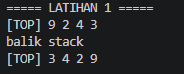
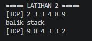
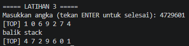

# <h1 align="center">Laporan Praktikum Modul 7 STACK</h1>
<p align="center">KHAIRIL IKHSAN HASIBUAN - 109082500174</p>

# Dasar Teori

### **A. Pengertian Stack**

**Stack** atau tumpukan merupakan salah satu jenis struktur data linier yang memiliki cara kerja seperti tumpukan barang. Data yang terakhir dimasukkan akan menjadi data pertama yang dikeluarkan. Prinsip tersebut dikenal dengan istilah **LIFO (Last In First Out)**.

Struktur data *stack* memiliki komponen yang hampir sama dengan *Singly Linked List*. Perbedaannya terletak pada penggunaan pointer, yaitu *stack* hanya menggunakan satu pointer utama yang disebut **TOP** untuk menunjukkan posisi elemen paling atas. Proses penambahan maupun pengambilan data hanya dilakukan melalui bagian atas *stack*. Setiap elemen saling terhubung menggunakan pointer `next`, sedangkan elemen paling bawah memiliki pointer `next` yang bernilai `Nil`.

### B. Operasi-Operasi dalam Stack

Pada struktur data *stack*, terdapat dua operasi utama yang digunakan untuk mengelola data, yaitu **Push** dan **Pop**. Operasi *Push* digunakan untuk menambahkan data ke dalam tumpukan, sedangkan *Pop* digunakan untuk mengambil atau menghapus data dari bagian paling atas.

**1. Push**

*Push* merupakan operasi untuk menambahkan elemen baru ke dalam *stack*. Proses penambahan data dilakukan pada posisi paling atas (TOP). Berikut langkah-langkah operasi *Push*:

| No. | Langkah | Keterangan |
|---|---|---|
| 1 | `P = alokasi(X)` | Membuat alokasi memori untuk elemen baru yang akan dimasukkan. |
| 2 | `P->next = S.Top` | Menghubungkan elemen baru dengan elemen yang sebelumnya berada di posisi TOP. |
| 3 | `S.Top = P` | Memperbarui pointer TOP agar menunjuk ke elemen baru. |

**2. Pop**

*Pop* merupakan operasi untuk mengambil sekaligus menghapus elemen dari bagian paling atas *stack*. Data yang diambil adalah data yang berada pada posisi TOP saat operasi dilakukan. Berikut langkah-langkah operasi *Pop*:

| No. | Langkah | Keterangan |
|---|---|---|
| 1 | `P = S.Top` | Menyimpan alamat elemen paling atas ke dalam variabel P. |
| 2 | `S.Top = (S.Top)->next` | Memindahkan posisi TOP ke elemen berikutnya. |
| 3 | `return P` | Mengembalikan elemen yang sebelumnya disimpan untuk digunakan atau diproses. |


### C. Primitif-Primitif dalam Stack

Primitif dalam *stack* merupakan kumpulan fungsi dasar yang digunakan untuk mengatur dan mengelola data di dalam tumpukan. Primitif pada *stack* hampir sama dengan struktur data list lainnya, tetapi jumlahnya lebih sedikit karena proses pengolahan data hanya berfokus pada elemen paling atas (TOP).

Beberapa primitif yang digunakan dalam *stack* antara lain:

| No. | Primitif | Keterangan |
|---|---|---|
| 1 | `createStack()` | Membuat atau menginisialisasi stack dalam kondisi kosong. |
| 2 | `isEmpty()` | Memeriksa apakah stack tidak memiliki elemen. |
| 3 | `alokasi()` | Menyediakan memori untuk elemen baru. |
| 4 | `dealokasi()` | Membebaskan memori dari elemen yang sudah tidak digunakan. |
| 5 | Fungsi pencarian | Digunakan untuk mencari elemen tertentu di dalam stack. |
| 6 | Fungsi lainnya | Berisi fungsi tambahan untuk mendukung proses pengelolaan stack. |

Primitif-primitif tersebut biasanya disimpan dalam beberapa file program, yaitu file `.cpp` untuk implementasi fungsi dan file `.h` untuk deklarasi fungsi. Dengan adanya pembagian tersebut, kode program menjadi lebih terstruktur dan mudah dikelola. 

### D. Stack (Representasi Tabel)

Selain menggunakan *pointer*, struktur data *stack* juga dapat dibuat menggunakan representasi tabel atau *array*. Cara kerja keduanya pada dasarnya sama, yaitu menggunakan prinsip **LIFO (Last In First Out)**. Perbedaannya terletak pada penyimpanan data, di mana representasi tabel menggunakan indeks array dan memiliki kapasitas penyimpanan yang sudah ditentukan sejak awal.

Sebagai contoh, sebuah *stack* memiliki kapasitas maksimum sebanyak 10 elemen, dengan indeks maksimum `Imax = 10`. Kondisi *stack* dikatakan kosong apabila nilai `Top = 0`, yang berarti belum ada data yang dimasukkan ke dalam tumpukan.


#### 1. Operasi pada Stack Representasi Tabel

Pada *stack* yang menggunakan representasi tabel atau *array*, terdapat dua operasi utama, yaitu **Push** dan **Pop**. Kedua operasi tersebut menggunakan indeks `Top` untuk mengatur posisi data yang akan ditambahkan maupun diambil.

**a. Push**

*Push* merupakan proses menambahkan data baru ke dalam *stack*. Penambahan dilakukan dengan menaikkan nilai indeks `Top` terlebih dahulu, kemudian data disimpan pada posisi tersebut. Jika kapasitas *stack* sudah penuh, maka akan terjadi kondisi **overflow**.

**b. Pop**

*Pop* merupakan proses mengambil data yang berada pada posisi paling atas *stack*. Data pada indeks `Top` disimpan terlebih dahulu ke dalam variabel penampung, kemudian nilai `Top` dikurangi satu. Data yang sebelumnya tersimpan tidak benar-benar dihapus dari array, tetapi sudah tidak dianggap sebagai bagian dari *stack*. Jika nilai `Top = 0`, maka terjadi kondisi **underflow** karena *stack* dalam keadaan kosong.

Berikut tabel langkah-langkah operasinya:

| Operasi | Langkah | Keterangan |
|---|---|---|
| Push | `Top = Top + 1` | Menaikkan indeks TOP ke posisi berikutnya. |
| Push | `S.Info[Top] = X` | Menyimpan data baru pada posisi TOP. |
| Pop | `Temp = S.Info[Top]` | Menyimpan data paling atas ke variabel penampung. |
| Pop | `Top = Top - 1` | Mengurangi indeks TOP ke posisi sebelumnya. |

**Kondisi pada Stack:**

| Kondisi | Keterangan |
|---|---|
| `Top = 0` | Stack dalam keadaan kosong (*underflow* jika dilakukan Pop). |
| `Top = Imax` | Stack sudah penuh (*overflow* jika dilakukan Push). |
| `0 < Top < Imax` | Stack masih memiliki data dan ruang kosong. |


#### 2. ADT Stack Representasi Tabel
Berikut adalah contoh *Abstract Data Type* (ADT) untuk Stack representasi tabel yang dideklarasikan dalam file `stack.h`:

```cpp
/* file : stack.h
   contoh ADT stack dengan representasi tabel */
#ifndef STACK_H_INCLUDED
#define STACK_H_INCLUDED

struct infotype {
    char nim[20];
    char nama[20];
};

struct Stack {
    infotype info[10];
    int Top;
};

/* prototype */
/********* pengecekan apakah Stack kosong *********/
int isEmpty(Stack S);
/* mengembalikan nilai 0 jika stack kosong */

/********* pembuatan Stack *********/
void createStack(Stack &S);
/* I.S. sembarang
   F.S. terbentuk stack dengan Top=0 */

/******** penambahan elemen pada Stack ********/
void push(Stack &S, infotype X);
/* I.S. Stack mungkin kosong
   F.S. menambahkan elemen pada stack dengan nilai X, TOP=TOP+1 */

/******** penghapusan elemen pada list ********/
void pop(Stack &S, infotype &X);
/* I.S. stack tidak kosong
   F.S. nilai info pada indeks TOP disimpan pada X, kemudian TOP=TOP-1 */

/******** proses semua elemen list ********/
void viewStack(Stack S);
/* I.S. stack mungkin kosong
   F.S. jika stack tidak kosong menampilkan semua info yang ada pada stack */

#endif // STACK_H_INCLUDED
```
## Guided 

### 1. Stack.h

```C++
/* file : stack.h
   contoh ADT stack dengan representasi tabel */
#ifndef STACK_H_INCLUDED
#define STACK_H_INCLUDED

#include <iostream>
using namespace std;

struct infotype {
    char nim[20];
    char nama[20];
};
struct Stack {
    infotype info[10];
    int Top;
};

/* prototype */
/******** pengecekan apakah Stack kosong *********/
int isEmpty(Stack S);
/* mengembalikan nilai 0 jika stack kosong */

/******** pembuatan Stack ********/
void createStack(Stack &S);
/* I.S. sembarang
   F.S. terbentuk stack dengan Top=0 */

/******** penambahan elemen pada Stack ********/
void push(Stack &S, infotype X);
/* I.S. Stack mungkin kosong
   F.S. menambahkan elemen pada stack dengan nilai X, TOP=TOP+1 */

/******** penghapusan elemen pada Stack ********/
void pop(Stack &S, infotype &X);
/* I.S. stack tidak kosong
   F.S. nilai info pada indeks TOP disimpan pada X, kemudian TOP=TOP-1 */

/******** proses semua elemen Stack *********/
void viewStack(Stack S);
/* I.S. stack mungkin kosong
   F.S. jika stack tidak kosong menampilkan semua info yang ada pada stack
*/
#endif // STACK_H_INCLUDED
```
Program C++ di atas adalah demo penggunaan Stack dengan data mahasiswa (nim dan nama) dari stack.h, bekerja dengan prinsip LIFO.

Program membuat stack kosong via createStack(S), menampilkan S.Top dan isinya. Lalu push tiga data (Andi, Budi, Citra) dan menampilkan isi stack dengan Citra di posisi teratas. Selanjutnya pop satu data (Citra) dan menampilkan sisa stack. Terakhir, pop sampai kosong tiga kali — aman dari underflow karena pop sudah mengecek isEmpty — lalu menampilkan stack kosong.

### 2. Stack.cpp

```C++
#include "stack.h"

int isEmpty(Stack S) {
    /* Top = 0 berarti kosong, sesuai komentar di stack.h dikembalikan 0 */
    if (S.Top == 0) {
        return 0;
    } else {
        return 1;
    }
}

void createStack(Stack &S) {
    S.Top = 0;
}

void push(Stack &S, infotype X) {
    if (S.Top < 10) {
        S.Top = S.Top + 1;
        S.info[S.Top - 1] = X;   /* Top 1..10 dipetakan ke indeks array 0..9 */
    } else {
        cout << "Stack penuh, data tidak bisa ditambahkan" << endl;
    }
}

void pop(Stack &S, infotype &X) {
    if (isEmpty(S) != 0) {
        X = S.info[S.Top - 1];
        S.Top = S.Top - 1;
    } else {
        cout << "Stack kosong, tidak ada data yang bisa diambil" << endl;
    }
}

void viewStack(Stack S) {
    if (isEmpty(S) == 0) {
        cout << "Stack kosong" << endl;
    } else {
        cout << "Isi stack (dari TOP):" << endl;
        for (int i = S.Top; i >= 1; i--) {
            cout << i << ". " << S.info[i - 1].nim << " - "
                 << S.info[i - 1].nama << endl;
        }
    }
}

```
Kode tersebut merupakan implementasi struktur data Stack (tumpukan) berbasis array statis berkapasitas 10 elemen dengan prinsip LIFO (Last In First Out). Stack menggunakan variabel Top sebagai penanda posisi teratas dengan penomoran 1-based, di mana Top = 0 menandakan kosong dan Top = 10 menandakan penuh. Karena array info tetap menggunakan indeks 0-based, setiap akses data dilakukan melalui rumus info[Top - 1].

Implementasi terdiri dari lima fungsi utama. Fungsi isEmpty mengecek kondisi stack dan mengembalikan nilai 0 jika kosong serta 1 jika tidak kosong — konvensi yang terbalik dari kebiasaan umum. Fungsi createStack menginisialisasi stack kosong dengan mengeset Top = 0. Fungsi push menambahkan elemen ke posisi teratas setelah memastikan Top < 10, dan menampilkan pesan error jika stack penuh untuk mencegah overflow. Fungsi pop mengambil dan menghapus elemen teratas setelah memastikan stack tidak kosong, menyalin data ke variabel X secara by reference lalu mengurangi Top, serta menampilkan pesan error jika kosong untuk mencegah underflow. Fungsi viewStack menampilkan seluruh isi stack dari TOP ke bawah menggunakan perulangan menurun, dengan pesan "Stack kosong" jika tidak ada data.

Secara keseluruhan, implementasi ini sudah lengkap dan aman karena setiap operasi dilengkapi pengecekan batas kapasitas, sehingga terhindar dari overflow maupun underflow, serta konsisten dengan sifat LIFO dalam menampilkan dan mengelola data.


### 3. main.cpp

```C++
#include <iostream>
#include <cstring>
#include "stack.h"
using namespace std;

int main() {
    Stack S;
    infotype data, hasil;

    createStack(S);
    cout << "Stack baru dibuat, Top = " << S.Top << endl;
    viewStack(S);

    cout << endl << "--- Push 3 data ---" << endl;
    strcpy(data.nim, "103112400001");
    strcpy(data.nama, "Andi");
    push(S, data);

    strcpy(data.nim, "103112400002");
    strcpy(data.nama, "Budi");
    push(S, data);

    strcpy(data.nim, "103112400003");
    strcpy(data.nama, "Citra");
    push(S, data);
    viewStack(S);

    cout << endl << "--- Pop 1 data ---" << endl;
    pop(S, hasil);
    cout << "Data yang diambil: " << hasil.nim << " - " << hasil.nama << endl;
    viewStack(S);

    cout << endl << "--- Pop sampai kosong ---" << endl;
    pop(S, hasil);
    pop(S, hasil);
    pop(S, hasil);
    viewStack(S);

    return 0;
}

```
Program C++ tersebut merupakan program demonstrasi struktur data Stack (tumpukan) yang menggunakan implementasi dari file header stack.h. Stack bekerja dengan prinsip LIFO (Last In First Out), yaitu data yang terakhir masuk akan pertama kali keluar.

Program ini menyimpan data mahasiswa bertipe infotype yang terdiri dari field nim dan nama (keduanya berupa array char, sehingga pengisiannya menggunakan strcpy). Variabel S bertipe Stack berfungsi sebagai wadah tumpukan, sedangkan data dan hasil bertipe infotype digunakan sebagai buffer untuk memasukkan dan menampung data hasil operasi.


## Unguided 

## SOAL Modul 7

### 1. Buatlah ADT Stack menggunakan ARRAY sebagai berikut di dalam file “stack.h”:
Type infotype : integer
Type Stack <
info : array [20] of integer
top : integer
>
procedure CreateStack( input/output S : Stack )
procedure push(input/output S : Stack, 
 input x : infotype)
function pop(input/output t S : Stack ) 
→ infotype
procedure printInfo( input S : Stack )
procedure balikStack(input/output S : 
 Stack )
 Buatlah implementasi ADT Stack menggunakan Array pada file “stack.cpp” dan “main.cpp”
```C 
int main()
{
cout << "Hello world!" << 
endl;
Stack S;
createStack(S);
Push(S,3);
Push(S,4);
Push(S,8);
pop(S)
Push(S,2);
Push(S,3);
pop(S);
Push(S,9);
printInfo(S);
cout<<"balik stack"<<endl;
balikStack(S);
printInfo(S);
return 0;
}
```

### 2. Tambahkan prosedur pushAscending( in/out S : Stack, in x : integer)

``` C 
int main()
{
Gambar 7-11 Output stack
STRUKTUR DATA 65
cout << "Hello world!" << endl;
Stack S;
createStack(S);
pushAscending(S,3);
pushAscending(S,4);
pushAscending(S,8);
pushAscending(S,2);
pushAscending(S,3);
pushAscending(S,9);
printInfo(S);
cout<<"balik stack"<<endl;
balikStack(S);
printInfo(S);
return 0;
}
```
### 3. Tambahkan prosedur getInputStream( in/out S : Stack ). Prosedur akan terus membaca dan 
menerima input user dan memasukkan setiap input ke dalam stack hingga user menekan 
tombol enter. Contoh: gunakan cin.get() untuk mendapatkan inputan user.
```C++
int main()
{
cout << "Hello world!" << endl;
Stack S;
createStack(S);
getInputStream(S);
printInfo(S);
cout<<"balik stack"<<endl;
balikStack(S);
printInfo(S);
return 0;
}
```
Jawaban Soal!

```C++
//Stack.h
#ifndef STACK_H_INCLUDED
#define STACK_H_INCLUDED

#include <iostream>
using namespace std;

typedef int infotype;

struct Stack {
    infotype info[20];
    int top;
};

// [1]
void createStack(Stack &S);
bool isEmpty(Stack S);
bool isFull(Stack S);
void push(Stack &S, infotype x);
infotype pop(Stack &S);
void printInfo(Stack S);
void balikStack(Stack &S);

// [2]
void pushAscending(Stack &S, int x);

// [3]
void getInputStream(Stack &S);

#endif // STACK_H_INCLUDED
```

```C++
//Stack.cpp
#include "stack.h"

// [1]
void createStack(Stack &S) {
    S.top = -1;
}

bool isEmpty(Stack S) {
    return (S.top == -1);
}

bool isFull(Stack S) {
    return (S.top == 19);
}

void push(Stack &S, infotype x) {
    if (!isFull(S)) {
        S.top = S.top + 1;
        S.info[S.top] = x;
    }
}

infotype pop(Stack &S) {
    infotype x = -1;
    if (!isEmpty(S)) {
        x = S.info[S.top];
        S.top = S.top - 1;
    }
    return x;
}

void printInfo(Stack S) {
    if (isEmpty(S)) {
        cout << "Stack kosong." << endl;
        return;
    }
    cout << "[TOP] ";
    for (int i = S.top; i >= 0; i--) {
        cout << S.info[i] << " ";
    }
    cout << endl;
}

void balikStack(Stack &S) {
    int arr[20], n = 0;
    while (!isEmpty(S)) {
        arr[n++] = pop(S);
    }
    for (int i = 0; i < n; i++) {
        push(S, arr[i]);
    }
}

// [2]
void pushAscending(Stack &S, int x) {
    Stack temp;
    createStack(temp);

    while (!isEmpty(S) && S.info[S.top] < x) {
        push(temp, pop(S));
    }

    push(S, x);

    while (!isEmpty(temp)) {
        push(S, pop(temp));
    }
}

// [3]
void getInputStream(Stack &S) {
    char c;
    cout << "Masukkan angka (tekan ENTER untuk selesai): ";
    while (cin.get(c) && c != '\n') {
        if (c >= '0' && c <= '9') {
            push(S, c - '0');
        }
    }
}
```

```C++
//main.cpp
#include "stack.h"

int main() {
    // [1]
    cout << "===== LATIHAN 1 =====" << endl;
    Stack S;
    createStack(S);
    push(S, 3);
    push(S, 4);
    push(S, 8);
    pop(S);
    push(S, 2);
    push(S, 3);
    pop(S);
    push(S, 9);
    printInfo(S);
    cout << "balik stack" << endl;
    balikStack(S);
    printInfo(S);

    // [2]
    cout << "\n===== LATIHAN 2 =====" << endl;
    Stack S2;
    createStack(S2);
    pushAscending(S2, 3);
    pushAscending(S2, 4);
    pushAscending(S2, 8);
    pushAscending(S2, 2);
    pushAscending(S2, 3);
    pushAscending(S2, 9);
    printInfo(S2);
    cout << "balik stack" << endl;
    balikStack(S2);
    printInfo(S2);

    // [3]
    cout << "\n===== LATIHAN 3 =====" << endl;
    Stack S3;
    createStack(S3);
    getInputStream(S3);
    printInfo(S3);
    cout << "balik stack" << endl;
    balikStack(S3);
    printInfo(S3);

    return 0;
}
```

### Output Unguided  :

##### Output 1

##### Output 2

##### Output 3



### 1. Pembuatan ADT Stack Menggunakan Array (Soal 1)

Pada tahap pertama, program dibuat untuk menerapkan struktur data *stack* menggunakan array dengan kapasitas maksimal 20 elemen. Di dalam file `stack.h` terdapat deklarasi struktur `Stack` yang memiliki array `info` untuk menyimpan data dan variabel `top` untuk menunjukkan posisi elemen paling atas.

Selanjutnya, pada file `stack.cpp` dibuat beberapa fungsi dasar, seperti `createStack`, `push`, `pop`, `isEmpty`, dan `isFull`. Fungsi `push` digunakan untuk menambahkan data ke dalam stack, sedangkan `pop` digunakan untuk mengambil data paling atas sekaligus mengurangi nilai `top`. Setelah itu, fungsi `printInfo` digunakan untuk menampilkan isi stack, sementara `balikStack` digunakan untuk membalik urutan data di dalam stack.

Pada `main.cpp`, dilakukan beberapa operasi penambahan dan pengambilan data sesuai instruksi soal. Setelah semua operasi selesai, program menampilkan isi stack sebelum dan sesudah dilakukan pembalikan menggunakan fungsi `balikStack`.

### 2. Penambahan Prosedur pushAscending (Soal 2)

Pada soal kedua, program dikembangkan dengan menambahkan prosedur `pushAscending` yang berfungsi untuk memasukkan data ke dalam stack berdasarkan urutan tertentu.

Prosesnya dilakukan dengan menggunakan stack sementara bernama `temp`. Ketika data baru akan dimasukkan, program terlebih dahulu memeriksa elemen paling atas pada stack utama. Jika nilainya lebih kecil dari data yang akan dimasukkan, elemen tersebut dipindahkan sementara ke dalam stack `temp`.

Setelah posisi yang sesuai ditemukan, data baru dimasukkan ke dalam stack utama. Kemudian, seluruh data yang sebelumnya dipindahkan ke stack sementara dikembalikan lagi ke stack utama. Dengan cara tersebut, data yang dimasukkan dapat tersusun berdasarkan urutan nilai pada stack.

Pada `main.cpp`, prosedur `pushAscending` dipanggil beberapa kali dengan nilai yang berbeda. Setelah seluruh data dimasukkan, fungsi `printInfo` digunakan untuk menampilkan hasilnya, kemudian fungsi `balikStack` dijalankan untuk membalik urutan stack.

### 3. Penambahan Prosedur getInputStream (Soal 3)

Pada soal ketiga, ditambahkan prosedur `getInputStream` yang digunakan untuk menerima masukan dari pengguna secara langsung melalui keyboard. Proses input dilakukan menggunakan `cin.get()` untuk membaca karakter yang dimasukkan satu per satu.

Program akan terus membaca input selama pengguna belum menekan tombol Enter. Setiap karakter yang terbaca akan diperiksa terlebih dahulu. Jika karakter tersebut berupa angka dari 0 sampai 9, maka nilainya akan dimasukkan ke dalam stack menggunakan prosedur `push`.

Setelah pengguna menekan Enter, proses input akan berhenti dan fungsi `printInfo` dipanggil untuk menampilkan seluruh data yang berhasil dimasukkan. Selanjutnya, fungsi `balikStack` dijalankan untuk membalik urutan data, kemudian hasil akhirnya ditampilkan kembali.


## Kesimpulan

Berdasarkan praktikum Modul 7 mengenai Stack, dapat disimpulkan beberapa hal sebagai berikut:

1. *Stack* merupakan salah satu struktur data linier yang menggunakan prinsip **LIFO (Last In First Out)**, yaitu data yang terakhir dimasukkan akan menjadi data pertama yang diambil atau dikeluarkan dari tumpukan.

2. Struktur data *stack* dapat dibuat menggunakan dua representasi, yaitu *pointer* (Linked List) dan tabel (*array*). Pada penggunaan array, jumlah data yang dapat disimpan memiliki batas sesuai kapasitas yang telah ditentukan.

3. Operasi utama dalam *stack* terdiri dari **Push** untuk menambahkan data pada posisi paling atas (TOP) dan **Pop** untuk mengambil data dari posisi tersebut. Selain itu, terdapat fungsi tambahan seperti `printInfo` untuk menampilkan isi stack dan `balikStack` untuk membalik urutan data.

4. Pada pengerjaan soal Unguided, berhasil dibuat prosedur `pushAscending` untuk memasukkan data berdasarkan urutan tertentu serta `getInputStream` untuk menerima input angka dari pengguna hingga tombol Enter ditekan.

5. Dalam pembuatan program *stack*, diperlukan pengecekan kondisi `isEmpty` dan `isFull` agar operasi dapat berjalan dengan baik. Pengecekan tersebut berguna untuk menghindari *underflow* ketika mengambil data dari stack kosong dan *overflow* ketika menambahkan data saat stack sudah penuh.

Dengan adanya praktikum ini, dapat dipahami cara kerja struktur data *stack*, mulai dari proses penambahan, pengambilan, pengurutan, hingga pembalikan data menggunakan bahasa pemrograman C++.

## Referensi
[1] Triase. (2020). Diktat Edisi Revisi: STRUKTUR DATA. Medan: Universitas Islam Negeri Sumatera Utara Medan.

[2] Indahyati, Uce., & Rahmawati Yunianita. (2020). BUKU AJAR ALGORITMA DAN PEMROGRAMAN DALAM BAHASA C++. Sidoarjo: Umsida Press. Diakses pada 10 Maret 2024 melalui https://doi.org/10.21070/2020/978-623-6833-67-4

[3] Modul Praktikum 7: Stack. Laboratorium Struktur Data. Fakultas Informatika, Universitas Telkom.


<br>...
